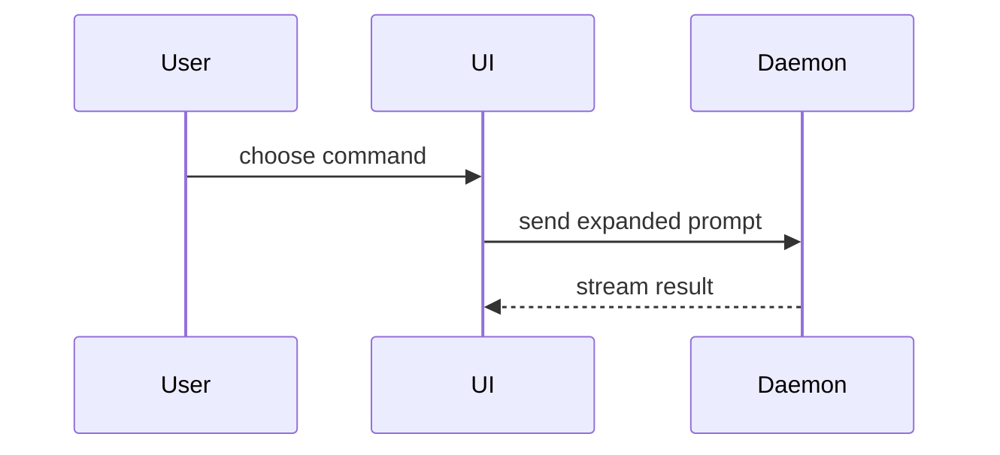

## Palo Alto rules

- Write the body to `.scratch/<ticket-id>/pr.md` and stop. Never push, never run `gh pr create`, never open a PR or comment on Jira: a human opens the PR after reading the diff.
- No network from the agent. Endpoint policy: never read `.env`, `./secrets/**`, `credentials.json`, `~/.ssh`, `~/.aws`, or `./build`; take results from console output.
- C++17, legacy target MSVC 19.16. Every verification claim names the command, compiler, and architecture. A pass on x64 does not prove x86.
- Title: `<ticket-id>: <imperative summary>`, under 72 characters.

Use this template for writing the PR body:

```markdown
## Summary

<diagram, diff-sketch, or tree>

## Evidence

- **Before:** <failing test run or console output>
  **After:** <passing test run or console output>

| Item | Value |
|---|---|
| Ticket and criteria covered | |
| Command, compiler, architecture, result | |
| Targets not run | |
| Review findings and decisions | |

## Merge Danger

**Door:** <one-way or two-way>

<optional: description>

**Blast Radius:** <one-word description>

<optional: potential ramifications of merge>
```

## Sections

Skip all preambles and keep prose brief. Use the user's domain language from `GLOSSARY.md`.

### Summary

Pick the smallest view that makes the key point clear.

- Show logic or an algorithm as pseudocode:

```text
on(save)
  if content is unchanged
    return cached result
  write new content
  return fresh result
```

- Show runtime control flow as a call tree:

```text
submitForm
  createSession
    persistPrompt
    launchAgent
  navigateToSession
```

- Show UI structure as a component tree, including state and module boundaries that matter:

```text
<SessionPage> (apps/example/src/routes/session.tsx)
  useSessionEvents()
  <SessionToolbar>
    <RunSkillButton> (packages/ui)
```

- Show file responsibility or a broad refactor as a shallow file tree:

```text
src/
├── commands/       # parses user actions
├── sessions/       # owns session state
└── transport/      # sends API requests
```

- Show component interaction, control flow, or data flow with Mermaid:



- Use `diff` when the point is what changes and the surrounding shape already exists. Match the diff shape to the topic.

For a component change:

```diff
 <SessionPage>
   useSessionEvents()
   <SessionToolbar>
+    <RunSkillButton />
   <SessionTimeline>
+    <SkillResultCard />
```

For a file-layout change:

```diff
 src/
 ├── commands/
+│   └── show-me.ts       # expands the slash command
 ├── sessions/
-└── transport.ts
+└── transport/
+    ├── client.ts
+    └── stream.ts
```

For a call-tree or call-stack change:

```diff
 submitForm
   createSession
     persistPrompt
+    expandSkillMention
     launchAgent
-  navigateToSession
+  navigateToSession
+    subscribeToEvents
```

For a state or control-flow change:

```diff
 on(save)
-  write content
+  if content is unchanged
+    return cached result
+  write new content
+  invalidate cache
```

- Show the whole block when most of it is new, when omitted context would hide ownership or order, or when the user needs a copyable target shape:

```ts
function expandSkill(command: string): string {
  const skillName = command.slice(1);
  return `use the ${skillName} skill`;
}
```

#### Guidance

Place each visual next to the short text it supports. Keep only the calls, files, props, states, and boundaries needed to answer the user's current question or the options to resolve the current discussion point.

You may use one of these, you may use several, it is unlikely you will use all of them. Use your judgement and don't overwhelm the user.

### Evidence

Concrete evidence that the change works. Show a before and after.

Execution-based evidence is required: the exact build and test command, its console output, the compiler and version, and the architecture. Show the exact test that now fails and passes, using pseudocode. Fill every row of the evidence table from real output; write "not run" rather than leaving a row out, and never claim a target you did not build.

### Merge Danger

Describe whether it's a one-way or two-way door. You can walk back through two-way doors, but not one-way doors. A PR that is cheap to roll back is lower risk. Changes that involve destructive actions or hard-to-reverse decisions are one-way doors. In legacy C++, treat changes to on-disk file formats, wire formats, public headers, and ABI (struct layout, type widths, exported symbols) as one-way doors.

The blast radius is the potential impact or scope of the changes introduced by this PR. Consider all possibilities. Examples are breakages for consumers of a public header, behaviour that differs between Windows (LLP64) and Linux (LP64), x86 and x64 differences, and performance on large inputs.
